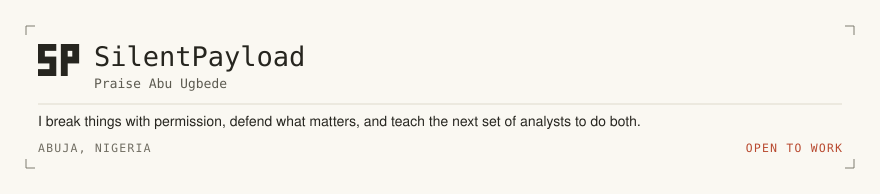
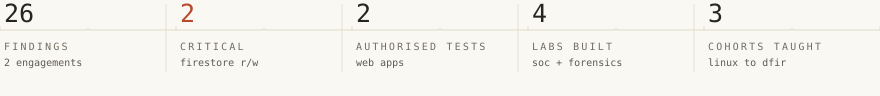
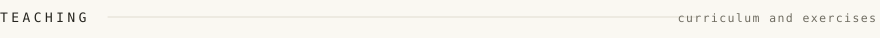
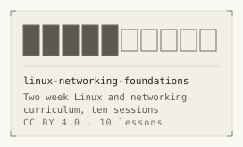
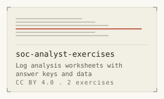
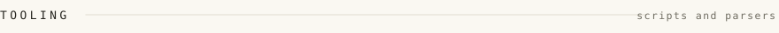
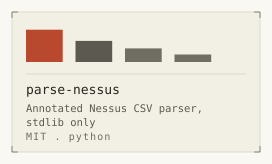
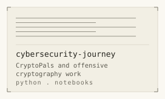
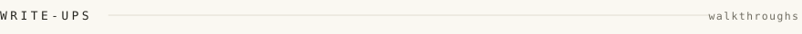
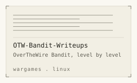

<picture><source media="(prefers-color-scheme: dark)" srcset="folio/header-dark.svg"><source media="(prefers-color-scheme: light)" srcset="folio/header-light.svg"></picture>

<picture><source media="(prefers-color-scheme: dark)" srcset="folio/figures-dark.svg"><source media="(prefers-color-scheme: light)" srcset="folio/figures-light.svg"></picture>

<picture><source media="(prefers-color-scheme: dark)" srcset="folio/label-teaching-dark.svg"><source media="(prefers-color-scheme: light)" srcset="folio/label-teaching-light.svg"></picture>

<a href="https://github.com/SilentPayload/linux-networking-foundations"><picture><source media="(prefers-color-scheme: dark)" srcset="folio/card-linux-networking-foundations-dark.svg"><source media="(prefers-color-scheme: light)" srcset="folio/card-linux-networking-foundations-light.svg"></picture></a><a href="https://github.com/SilentPayload/soc-analyst-exercises"><picture><source media="(prefers-color-scheme: dark)" srcset="folio/card-soc-analyst-exercises-dark.svg"><source media="(prefers-color-scheme: light)" srcset="folio/card-soc-analyst-exercises-light.svg"></picture></a>

[linux-networking-foundations](https://github.com/SilentPayload/linux-networking-foundations) · [soc-analyst-exercises](https://github.com/SilentPayload/soc-analyst-exercises)

<picture><source media="(prefers-color-scheme: dark)" srcset="folio/label-tooling-dark.svg"><source media="(prefers-color-scheme: light)" srcset="folio/label-tooling-light.svg"></picture>

<a href="https://github.com/SilentPayload/parse-nessus"><picture><source media="(prefers-color-scheme: dark)" srcset="folio/card-parse-nessus-dark.svg"><source media="(prefers-color-scheme: light)" srcset="folio/card-parse-nessus-light.svg"></picture></a><a href="https://github.com/SilentPayload/cybersecurity-journey"><picture><source media="(prefers-color-scheme: dark)" srcset="folio/card-cybersecurity-journey-dark.svg"><source media="(prefers-color-scheme: light)" srcset="folio/card-cybersecurity-journey-light.svg"></picture></a>

[parse-nessus](https://github.com/SilentPayload/parse-nessus) · [cybersecurity-journey](https://github.com/SilentPayload/cybersecurity-journey)

<picture><source media="(prefers-color-scheme: dark)" srcset="folio/label-write-ups-dark.svg"><source media="(prefers-color-scheme: light)" srcset="folio/label-write-ups-light.svg"></picture>

<a href="https://github.com/SilentPayload/OTW-Bandit-Writeups"><picture><source media="(prefers-color-scheme: dark)" srcset="folio/card-OTW-Bandit-Writeups-dark.svg"><source media="(prefers-color-scheme: light)" srcset="folio/card-OTW-Bandit-Writeups-light.svg"></picture></a>

[OTW-Bandit-Writeups](https://github.com/SilentPayload/OTW-Bandit-Writeups)

---

[portfolio](https://praiz-abu-portfolio.vercel.app) · [hackerone](https://hackerone.com/unpatchedxyz) · [linkedin](https://www.linkedin.com/in/abu-praise-0a1540337)

Generated by <code>scripts/build_folio.py</code> from <code>data/</code> on 2026-10-25. Do not edit this file by hand.
